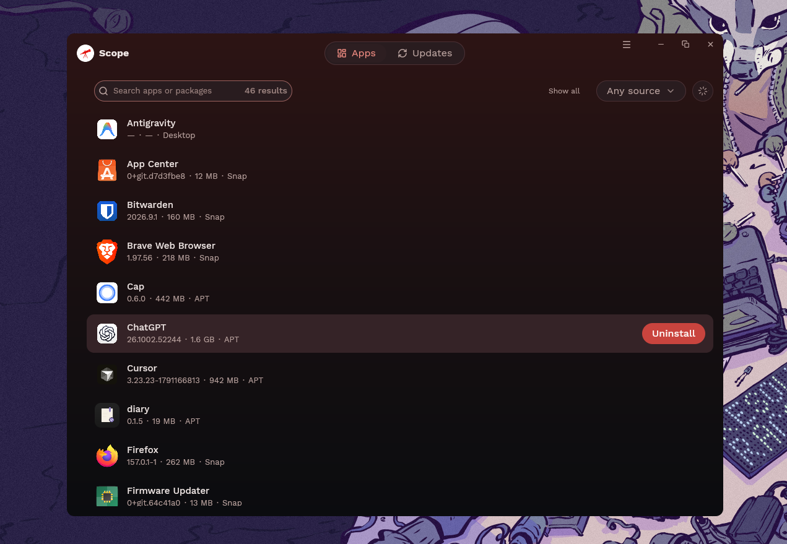
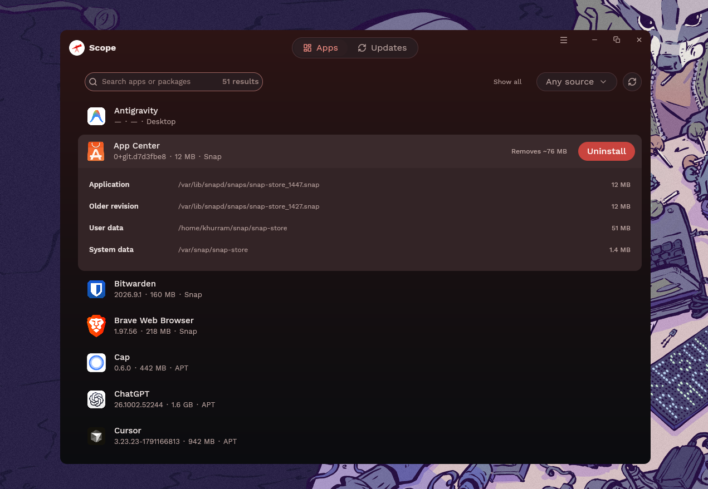

<p align="center">
  
</p>

<h1 align="center">Scope for Linux</h1>

<p align="center">Browse, update, and uninstall Linux apps in one place.</p>

<p align="center">
  <a href="https://khurrambhutto.github.io/scope/">Website</a> ·
  <a href="https://github.com/khurrambhutto/scope/releases">Downloads</a> ·
  <a href="https://github.com/khurrambhutto/scope/issues">Report an issue</a>
</p>

Scope for Linux is a desktop app written in Rust with GPUI. It combines installed apps and command-line tools into one searchable list, with package details and a confirmation preview before every update or uninstall. Ubuntu on x86-64 is the primary target.

<p align="center">
  
  
</p>

## Install

Download the `.deb` or AppImage from [Releases](https://github.com/khurrambhutto/scope/releases). For the v0.3.5 `.deb`, run:

```bash
sudo apt install ./scope_0.3.5_amd64.deb
```

For the portable AppImage:

```bash
chmod +x Scope-0.3.5-x86_64.AppImage
./Scope-0.3.5-x86_64.AppImage
```

Official `.deb` builds support self-updates with signed checksum verification.

## Usage

Search or filter by source, select an app to inspect its details, then choose **Update** or **Uninstall**. Review the command preview and confirm. Scope rechecks the installation before running the package manager and streams its output. Privileged operations use the standard Polkit dialog.

Switch to **Updates** to see available updates. **Show all** reveals the scanned inventory while keeping protected packages locked.

## Supported sources

| Source | Uninstall | Update |
| --- | --- | --- |
| APT, Snap, Flatpak | Yes | Yes |
| uv tools, pipx | Yes | Yes |
| Cargo | Yes | Yes |
| AppImage, unmanaged desktop launchers | Discovery only | Discovery only |

APT scans manual installs; Snap and Flatpak exclude runtimes. Tool management requires verified user-owned installations inside your home directory. Global pipx installs and untracked Cargo binaries are unsupported. Git/local Python sources and local/custom-registry Cargo sources have no automatic updates. Pins and supported installation constraints are respected; pipx upgrades may drop original version constraints. Shared caches, interpreters, toolchains, and personal data are kept.

## Build from source

Install Rust stable and the Linux dependencies, then run:

```bash
sudo apt install build-essential pkg-config libfontconfig1-dev libx11-dev libx11-xcb-dev \
  libxcb1-dev libxkbcommon-dev libxkbcommon-x11-dev libwayland-dev wayland-protocols
git clone https://github.com/khurrambhutto/scope.git
cd scope
cargo run
```

## Contributing

See [CONTRIBUTING.md](CONTRIBUTING.md) for setup, checks, and pull request guidelines. [AGENTS.md](AGENTS.md) describes the architecture and safety rules. Report bugs through [Issues](https://github.com/khurrambhutto/scope/issues) and security vulnerabilities through [SECURITY.md](SECURITY.md).

## License

[MIT](LICENSE)
